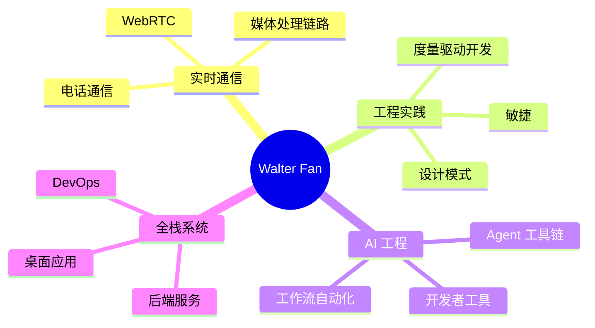
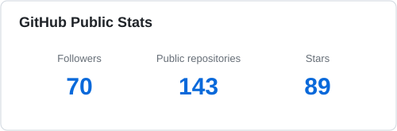
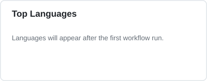

<h1 align="center">你好，我是 Walter Fan</h1>

<a href="README.md">English</a> | <a href="README.zh-CN.md">简体中文</a>

  <strong>全栈工程师 · 实时通信实践者 · AI 工程探索者</strong>

  
  
  

我从事后端服务、实时通信、Web 应用、桌面工具和 AI 辅助工程工作，也持续整理工程实践、度量驱动开发、实时通信、设计模式、安全和可靠系统构建方面的电子书，个人笔记与工具。

## 工程方向

## 电子书与个人笔记

| 主题 | 仓库 | 在线阅读 |
| --- | --- | --- |
| 度量驱动开发 | [mdd](https://github.com/walterfan/mdd) | [在线阅读](https://walterfan.github.io/mdd) |
| WebRTC 入门 | [webrtc_primer](https://github.com/walterfan/webrtc_primer) | [在线阅读](https://walterfan.github.io/webrtc_note) |
| AI 时代的软件工程 | [ai-engineering-primer](https://github.com/walterfan/ai-engineering-primer) | [在线阅读](https://walterfan.github.io/ai-engineering-primer) |
| 驾驭 AI：塑造智能体的艺术 | [ai-harness-primer](https://github.com/walterfan/ai-harness-primer) | [在线阅读](https://walterfan.github.io/ai-harness-primer/) |
| AI Agent 循环教程 | [agent-loop-tutorial](https://github.com/walterfan/agent-loop-tutorial) | - |
| 使用 Tauri 和 Rust 开发桌面应用 | [rust-tauri-primer](https://github.com/walterfan/rust-tauri-primer) | [在线阅读](https://walterfan.github.io/rust-tauri-primer) |
| OpenResty 入门 | [openresty-primer](https://github.com/walterfan/openresty-primer) | - |
| 敏捷之道 | [the-tao-of-agile](https://github.com/walterfan/the-tao-of-agile) | - |
| 安全指南 | [security-master](https://github.com/walterfan/security-master) | - |
| DevOps 实用手册 | [devops-cookbook](https://github.com/walterfan/devops-cookbook) | - |
| GStreamer 实用手册 | [gstreamer-cookbook](https://github.com/walterfan/gstreamer-cookbook) | - |
| C++ 常见的 100 个错误 | [cpp-100-mistakes](https://github.com/walterfan/cpp-100-mistakes) | 汇集常见 C++ 错误的实用读物，另有[在线版本](https://walterfan.github.io/cpp-100-mistakes)。 |

## 个人项目

### 近期项目

| 项目 | 方向 | 说明 |
| --- | --- | --- |
| [ajb-demo](https://github.com/walterfan/ajb-demo) | 自适应抖动缓冲实验 | C++20 演示程序，在相同网络轨迹下对比小型固定、大型固定和自适应缓冲；提供 Web 与终端界面、音频播放及 WAV/CSV 导出，用于观察延迟和播放连续性。 |
| [lua-playground](https://github.com/walterfan/lua-playground) | 交互式 Lua 学习 | 基于 OpenResty 的网页练习场，可在受限的 LuaJIT 环境中运行 Lua 代码，捕获输出、管理代码片段，并通过示例讲解语言基础和常见错误。 |
| [gitman](https://github.com/walterfan/gitman) | 本地 Git 助手 | Python 命令行工具，可将自然语言转换为经过审阅的 Git 命令计划，根据实际差异起草提交说明，并在确认后执行；还提供可选的本机 Web 界面。 |
| [markpad](https://github.com/walterfan/markpad) | 本地 Markdown 编辑、阅读、翻译与图表渲染 | Python/Poetry 网页工具，包含文件树、Markdown 源码与 HTML 预览分栏、护眼主题、Mermaid 和 PlantUML 渲染，以及兼容 OpenAI 接口的 LLM 翻译。 |
| [webrtc-to-freeswitch](https://github.com/walterfan/webrtc-to-freeswitch) | 浏览器 WebRTC 与 FreeSWITCH 通话 | Vue 3 + TypeScript 客户端和 FastAPI 服务，通过现有 FreeSWITCH 部署建立安全的 SIP over WebSocket 音频通话。 |

### Lazy Rabbit Studio

| 项目 | 方向 | 说明 |
| --- | --- | --- |
| [lazy-code-kg](https://github.com/walterfan/lazy-code-kg) | 面向 AI Agent 的代码知识图谱 | 将源码索引为实体和关系，使用 sqlite-vec 存入 SQLite，并提供混合搜索和 MCP 工具。 |
| [lazy-rabbit-skills](https://github.com/walterfan/lazy-rabbit-skills) | 可复用 AI Agent 技能集 | 包含文档、项目知识库、图表渲染、代码审查、语言开发、运维辅助、规划和质量工作流等技能，可安装到 Claude、Codex、Cursor、opencode 等 Agent。 |
| [lazy-rabbit-mmuc](https://github.com/walterfan/lazy-rabbit-mmuc) | WebRTC 多媒体多人聊天 | 使用 Pion 和 TypeScript 构建的多媒体多人聊天应用。 |
| [Lazy Todo App](https://github.com/walterfan/lazy-todo-app) | 个人效率桌面应用 | 提供待办清单、便笺、番茄钟、工具箱和虚拟 Agent。 |
| [Smart Form Instructor](https://github.com/walterfan/smart-form-instructor) | 智能表单填写与 AI 工作流 | 从自然语言中提取结构化表单数据，再运行包含 LLM 决策节点的 DAG 工作流，用于审核、路由和审计。 |

### 效率工具

| 项目 | 方向 | 说明 |
| --- | --- | --- |
| [gitman](https://github.com/walterfan/gitman) | 自然语言 Git 助手 | 根据提示规划 Git 命令、依据实际差异撰写提交说明，并在用户确认后执行。 |
| [Daily Sticky Note](https://github.com/walterfan/daily-sticky-note) | 日常便笺与番茄钟 | Python 桌面便笺应用，支持番茄钟、YAML 模板和可选的 LLM 辅助。 |
| [GStreamer Pipeline Verifier](https://github.com/walterfan/gst-pipeline-verifier) | 媒体处理链路验证 | 用于验证 GStreamer 处理链路的 C++ 工具。 |
| [WebRTC Stats Tool](https://github.com/walterfan/webrtc_stats) | WebRTC 诊断 | Chrome WebRTC Internals 导出数据的解析与分析工具。 |
| [Video Codec Analyzer](https://github.com/walterfan/video_codec_analyzer) | 视频编解码分析 | 使用 C++ 编写的 H.264 分析工具。 |
| [Audio Codec Analyzer](https://github.com/walterfan/audio_codec_analyzer) | 音频采集链路分析 | C++20 命令行工具，用于测量会议音频链路中的 AEC、降噪、AGC 和 Opus 编码。 |
| [gouml](https://github.com/walterfan/gouml) | 从 Go 源码生成 UML | 使用 `go/types` 生成 PlantUML 或 Mermaid 类图，支持隐式接口实现、类型嵌入，以及可选的 PNG/SVG 渲染。 |
| [gtest2html](https://github.com/walterfan/gtest2html) | 测试报告转换 | 将 GoogleTest XML 报告转换为 Markdown 或 HTML 的 Python 工具。 |

### AI 与媒体实验

| 项目 | 方向 | 说明 |
| --- | --- | --- |
| [AI Dress Recommender](https://github.com/walterfan/ai-dress-recommender) | AI 穿搭推荐 | 根据天气并借助 AI 和 LLM 提供穿搭建议。 |
| [WebRTC Transcriber](https://github.com/walterfan/webrtc-transcriber) | 语音转写 | 使用 WebRTC 录音并将语音转换为文本。 |
| [OCR Web App](https://github.com/walterfan/webocr) | OCR | 基于 libtesseract 的图片文字识别应用。 |
| [video_to_text](https://github.com/walterfan/video_to_text) | 视频文字提取 | 从视频或图像中提取文字，并生成字幕翻译。 |
| [face-detection-webrtc](https://github.com/walterfan/face-detection-webrtc) | 人脸检测、特征点、训练与识别演示 | 计算机视觉练习场，使用 OpenCV Haar 检测、MediaPipe Face Mesh、LBPH 识别、FastAPI、Vue/Vite，并通过 WebRTC `getUserMedia` 调用浏览器摄像头。 |

### 示例与代码练习

| 项目 | 方向 | 说明 |
| --- | --- | --- |
| [WebRTC Snippets](https://github.com/walterfan/webrtc_snippets) | WebRTC 示例 | WebRTC 相关代码片段与实验。 |
| [WebRTC Video Chat](https://github.com/walterfan/webrtc_video_chat) | 实时视频 | WebRTC 视频聊天示例。 |
| [WebRTC Remote Sharing](https://github.com/walterfan/webrtc_remote_sharing) | 远程共享 | 基于 WebRTC 的远程共享示例。 |
| [Code Kata](https://github.com/walterfan/code-kata) | 编程练习 | 涵盖 C++、Java、Python、Go、JavaScript、TypeScript、HTML 和 CSS 的练习。 |

更多项目请访问 [github.com/walterfan?tab=repositories](https://github.com/walterfan?tab=repositories)。

## 技术栈

## GitHub 数据

  
  

